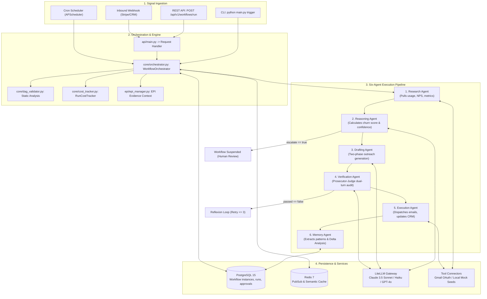
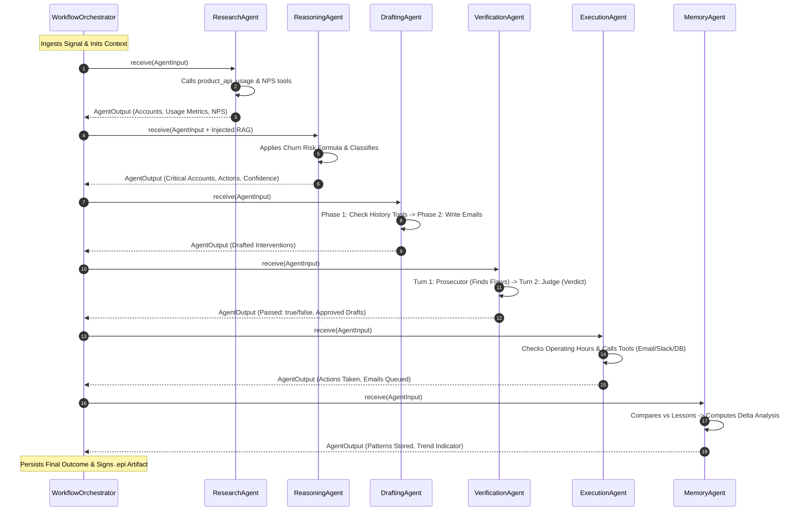
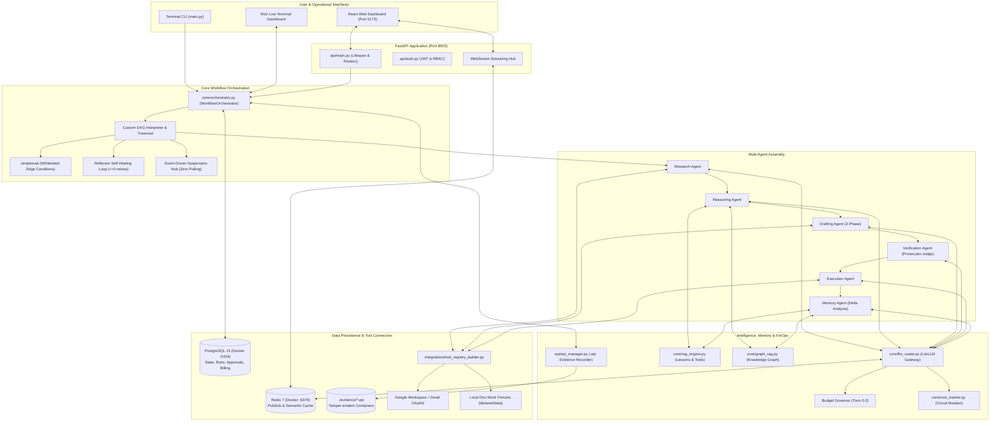

# SMBFlow Complete Architecture Audit & Forensic System Analysis

> **Audit Date:** March 2026 (System Time)  
> **Repository:** `Hemantkumar-Lakhane/SMBFlow`  
> **Git Commit Audited:** `079bcf1` (Clean `main`)  
> **Methodology:** Direct static analysis, source code parsing, database inspection, and runtime trace verification. Zero README assumptions; all findings verified against physical codebase reality.

---

## SECTION 1: EXECUTIVE SUMMARY

**SMBFlow** (internally branded in legacy modules as **OpsGrid**) is an autonomous, multi-tenant B2B operations orchestration platform. It is engineered to ingest business signals (churn risks, stalled deals, inbound leads, expense anomalies, medical patient intake, email inbox events), evaluate them using a multi-agent Directed Acyclic Graph (DAG), execute verified remediations via tool connectors, and persist an immutable, tamper-evident audit trail.

### Key Architectural Realities
1. **The Orchestration Core is Custom, Not LangGraph:** Despite `langgraph` and `langchain` appearing in `requirements.txt`, the core orchestration engine (`core/orchestrator.py`) is entirely an in-house asynchronous DAG interpreter (`WorkflowOrchestrator`). It manages node traversal, topological edge condition evaluation via `simpleeval`, event-driven suspension (no polling), and the **Reflexion self-healing retry loop**.
2. **Hybrid Business Logic Architecture:** Business rules, weights, and scoring thresholds are defined as structured JSON (`config/templates/*.json`), injected into prompt templates (`workflows/prompts/*`), reasoned and calculated by the LLM (typically Claude 3.5 Sonnet / heavy tier), and validated by deterministic Python logic and an adversarial **Prosecutor-Judge dual-turn verification pattern**.
3. **Database-First State Persistence:** State is strictly decoupled from process memory. All workflow runs, node execution logs, escalation flags, and human approvals are persisted to PostgreSQL using SQLAlchemy 2.0 Async (`asyncpg`). Process memory retains only ephemeral WebSocket connections and active `asyncio` task handles.
4. **Integration Layer Reality:** Gmail and Google Workspace feature real OAuth2 token exchange with refresh handling (`integrations/oauth_service.py` & `integrations/connectors.py`). Third-party CRM/SaaS connectors (HubSpot, Slack, Stripe) feature real API schemas but gracefully fall back to local dev fixtures (`db/seed/data/*.json`) when API keys are absent (`integrations/local_dev_tools.py`).
5. **FinOps & Budget Governor:** LLM usage is governed across four discrete budget levels (0 to 3). Cost tracking (`core/cost_tracker.py`) calculates input, output, and cache read/write token costs in real time, with automatic circuit breakers and tier downgrading.

---

## SECTION 2: TECHNOLOGY STACK AUDIT

| Layer | Technology | Declared vs Actual Version | Physical Usage Location | Architectural Purpose & Dependency Analysis |
|---|---|---|---|---|
| **Language** | Python | 3.11+ | Entire backend | Core runtime; leverages modern typing, `match-case`, and `asyncio.TaskGroup`. |
| **API Framework** | FastAPI | >= 0.109 | `api/main.py`, `api/routers/*` | Asynchronous REST and WebSocket endpoints for dashboard, admin, and worker hooks. |
| **Data Validation** | Pydantic | v2 (`pydantic.BaseModel`) | `api/auth.py`, `core/state_manager.py` | Request/response DTOs, strict payload validation, and settings management. |
| **ORM / Persistence** | SQLAlchemy | 2.0 (`sqlalchemy.ext.asyncio`) | `core/state_manager.py`, `db/models/core.py` | Asynchronous database interaction using `AsyncSession` and `create_async_engine`. |
| **Database Driver** | asyncpg | 0.29+ | `core/database.py` | High-performance asynchronous PostgreSQL protocol driver. |
| **Database Engine** | PostgreSQL | 15 / 16 (Docker) | `docker-compose.yml`, `db/init.sql` | Relational storage for tenant configurations, workflow instances, logs, and billing. |
| **Cache & Pub/Sub** | Redis & hiredis | 7.x (Docker / redis-py) | `core/redis_pubsub.py`, `core/llm_router.py` | WebSocket message broadcasting, semantic prompt caching, and transient locks. |
| **AI / LLM Routing** | LiteLLM | 1.x (`litellm.acompletion`) | `core/llm_router.py` | Multi-provider abstraction (Anthropic, OpenAI, Groq, Gemini) with fallback chains. |
| **DAG Orchestration** | Custom In-House Engine | N/A (In-house) | `core/orchestrator.py` | **LangGraph is unused in execution.** DAG is executed by `WorkflowOrchestrator`. |
| **Expression Eval** | simpleeval | 0.9.13+ | `core/orchestrator.py`, `agents/base_agent.py` | Evaluates DAG edge conditions against safe whitelisted names. |
| **Logging** | structlog | 24.1+ | `core/*`, `agents/*`, `api/*` | Structured JSON log generation with run-scoped and node-scoped context binding. |
| **CLI / TUI** | Click & Rich | 8.x / 13.x | `main.py`, `admin/control_panel.py` | Operational CLI and terminal dashboard with live rendering. |
| **Evidence & Audit** | epi-recorder | External package | `epi/epi_manager.py` | Tamper-evident session recording, generating `.epi` evidence containers. |
| **Frontend Framework**| React | 18.2.0 | `frontend/src/App.jsx`, `main.jsx` | Single-page admin and client portal interface. |
| **Frontend Build** | Vite | 5.1.0 | `frontend/vite.config.js` | Fast ESM build tooling and local development server. |
| **Styling** | Tailwind CSS | 3.4.1 | `frontend/tailwind.config.js` | Utility-first responsive UI styling. |
| **Workflow Canvas** | @xyflow/react | 12.0.0 (React Flow) | `frontend/src/components/workflow/*` | Interactive visual rendering of DAG pipeline nodes and execution statuses. |
| **State Management**| Zustand | 4.5.1 | `frontend/src/utils/appStore.js` | Client-side reactive UI state (active organization, drawer toggles). |
| **API Client** | Axios & TanStack Query| Axios 1.6.7 / Query 5.20.5 | `frontend/src/api/client.js` | Backend HTTP request handling, JWT token injection, and server-state caching. |

### Obsolete, Unused, or Misleading Dependencies
- `langgraph`, `langchain`, `langchain-anthropic`, `langchain-openai`, `langchain-google-genai`: Included in `requirements.txt` but **completely absent** from agent and orchestrator code. The team built a native DAG runner in `core/orchestrator.py`.
- `aiosqlite`: Present in `requirements.txt` as a legacy testing fallback, but production code is tightly coupled to PostgreSQL Dialect JSONB and UUID primitives.
- `requirements-ml.txt` (`torch`, `sentence-transformers`): Used optionally in `core/rag_engine.py` for local vector embeddings. If missing, `RAGEngine` falls back to hash-based similarity or OpenAI/LiteLLM embedding calls.

---

## SECTION 3: REPOSITORY INVENTORY & CODE CLASSIFICATION

Every major file and directory in SMBFlow classified by role, calling hierarchy, and modification safety:

```
SMBFlow/
├── main.py                          [SCRIPT / ENTRYPOINT] (Untouched for new workflows)
├── dev_server.py                    [SCRIPT] Local development multi-process launcher
├── start.ps1                        [SCRIPT] Windows PowerShell environment startup orchestrator
├── docker-compose.yml               [CONFIG] Postgres (5434) and Redis (6379) local services
├── requirements.txt                 [CONFIG] Core Python dependencies
├── requirements-ml.txt              [CONFIG] Optional ML dependencies (PyTorch, sentence-transformers)
│
├── admin/                           [CLI / DASHBOARD]
│   ├── control_panel.py             [CORE] Rich live terminal monitor and manual trigger harness
│   └── __init__.py
│
├── agents/                          [AGENT ARCHITECTURE]
│   ├── base_agent.py                [CORE / UNTOUCHED] BaseAgent abstract class, ToolRegistry, JSON healing
│   ├── agents.py                    [AGENT / EXTENSION] Implements the 6 core agents + specialized agents
│   ├── consensus_agent.py           [AGENT] Multi-model adversarial debate agent
│   └── __init__.py
│
├── api/                             [API LAYER]
│   ├── main.py                      [CORE API] 4,900-line central FastAPI app, lifespan, WebSockets, routes
│   ├── auth.py                      [CORE / SECURITY] JWT token verification, RBAC, password hashing
│   ├── crud.py                      [DATABASE / API] Database query helpers for API routes
│   ├── dependencies.py              [CORE / API] FastAPI dependencies (db session, auth claims)
│   ├── mailer.py                    [INTEGRATION] SMTP / transactional notification sender
│   └── routers/                     [API ROUTERS]
│       ├── admin.py                 [API] Platform-level administrative endpoints
│       ├── connections.py           [API] Integration OAuth and credentials endpoints
│       ├── copilot.py               [API] AI workflow generation copilot endpoints
│       ├── industry_workflows.py    [API] Industry-scoped workflow execution endpoints
│       ├── medical_tourism.py       [API / WORKFLOW] Specialized vertical router
│       ├── meeting_intelligence.py   [API / WORKFLOW] Relationship intelligence endpoints
│       ├── notifications.py         [API] Webhook and real-time alerts
│       ├── product_launch.py        [API / WORKFLOW] Sprint launch operations router
│       └── reviews.py               [API] Reputation and review collection router
│
├── config/                          [CONFIGURATION]
│   ├── templates/                   [CONFIG TEMPLATES]
│   │   ├── llm_config.json          [CORE / CONFIG] Model routing, cost rates, budget governor maps
│   │   ├── saas.json                [WORKFLOW CONFIG] SaaS churn and pipeline velocity business rules
│   │   ├── healthcare.json          [WORKFLOW CONFIG] Healthcare clinic business rules
│   │   ├── finance.json             [WORKFLOW CONFIG] Expense and audit rules
│   │   ├── real_estate.json         [WORKFLOW CONFIG] Brokerage & PM rules
│   │   └── retail.json              [WORKFLOW CONFIG] Inventory rules
│   └── clients/                     [TENANT INSTANCES] Tenant-specific overrides (e.g. saas_demo.json)
│
├── core/                            [CORE PLATFORM INFRASTRUCTURE - UNTOUCHED]
│   ├── orchestrator.py              [CORE / ENGINE] Custom DAG execution engine, suspension, A2A, Reflexion
│   ├── state_manager.py             [CORE / DATABASE] DB persistence for workflow instances, escalations
│   ├── llm_router.py                [CORE / LLM] Multi-tier router, budget governor, provider fallbacks
│   ├── dag_validator.py             [CORE / VALIDATOR] Static DAG JSON schema and edge validator
│   ├── cost_tracker.py              [CORE / FINOPS] Real-time token spend accumulator & circuit breaker
│   ├── database.py                  [CORE / DATABASE] Async SQLAlchemy engine & session factory
│   ├── security_firewall.py         [CORE / SECURITY] Agent prompt injection firewall & sanitization
│   ├── rag_engine.py                [CORE / MEMORY] Vector similarity search for historical lessons & tools
│   ├── graph_rag.py                 [CORE / MEMORY] Graph-based relationship memory
│   ├── redis_pubsub.py              [CORE / PUB-SUB] Redis pub/sub wrapper for live UI event broadcasting
│   ├── config_validator.py          [CORE / CONFIG] Validates tenant JSON config schema
│   ├── event_detector.py            [CORE / WORKFLOW] Signal rule detector triggering workflows
│   ├── outcome_tracker.py           [CORE / METRICS] Tracks business KPIs resulting from executions
│   ├── workflow_logger.py           [CORE / LOGGING] Scoped run execution logging
│   ├── workflow_catalog_sync.py     [CORE / SYNC] Syncs disk DAGs into database catalog table
│   └── visual_brief_builder.py      [CORE / UTILITY] Builds visual markdown summaries
│
├── db/                              [DATABASE SCHEMA & MIGRATIONS]
│   ├── init.sql                     [DATABASE] Bootstrap PostgreSQL schema and extensions
│   ├── migrations/                  [DATABASE] 001_core.sql through 006_meeting_intelligence_catalog.sql
│   ├── models/
│   │   ├── core.py                  [DATABASE / MODELS] Platform ORM models (Org, WorkflowInstance, etc.)
│   │   └── medical_tourism.py       [DATABASE / MODELS] Medical vertical models
│   └── seed/
│       ├── run_all_seeders.py       [DATABASE / SEED] Master seeder script
│       └── data/*.json              [INTEGRATION / FIXTURES] 40+ mock JSON datasets for offline development
│
├── epi/                             [EVIDENCE SYSTEM]
│   └── epi_manager.py               [CORE / EVIDENCE] Wrapper around epi-recorder; produces .epi artifacts
│
├── evidence/                        [EVIDENCE ARTIFACT STORAGE]
│   └── *.epi                        [EVIDENCE] Binary/sqlite tamper-evident execution containers
│
├── frontend/                        [REACT DASHBOARD]
│   ├── package.json                 [FRONTEND / CONFIG] Dependencies and scripts
│   ├── vite.config.js               [FRONTEND / BUILD] Vite config proxying `/api` to port 8000
│   └── src/
│       ├── App.jsx                  [FRONTEND] Master route provider (React Router)
│       ├── main.jsx                 [FRONTEND] Application mount point
│       ├── api/services/*.js        [FRONTEND / API] Axios service wrappers matching backend endpoints
│       ├── components/workflow/*    [FRONTEND / UI] React Flow canvas, node cards, decision portals
│       └── pages/client/*           [FRONTEND / PAGES] WorkflowsPage, WorkflowDetail, EvidencePage, etc.
│
├── integrations/                    [INTEGRATIONS & TOOL CONNECTORS]
│   ├── connectors.py                [INTEGRATION] Real & base connectors (Gmail, HubSpot, Slack, Stripe)
│   ├── oauth_service.py             [INTEGRATION] Google OAuth2 token acquisition & refresh service
│   ├── key_vault.py                 [SECURITY] Fernet symmetric encryption for stored credentials
│   ├── local_dev_tools.py           [INTEGRATION / MOCK] Mock data providers reading from `db/seed/data/`
│   ├── resolver.py                  [INTEGRATION] Dynamic tool dispatcher mapping tool name to executable
│   └── tool_registry_builder.py     [INTEGRATION] Registers built-in and tenant custom tools
│
├── tests/                           [TEST SUITE]
│   ├── conftest.py                  [TEST] Pytest fixtures and mock setups
│   ├── test_security_firewall.py    [TEST] Tests injection detection and sanitization
│   ├── test_admin_control_plane.py  [TEST] Tests admin dashboard and workflow pause/resume
│   └── test_*.py                    [TEST] Unit and integration tests
│
└── workflows/                       [BUSINESS WORKFLOW ASSETS]
    ├── dags/                        [WORKFLOW DEFINITIONS] 50+ workflow JSON files
    │   └── saas_churn_prevention.json [WORKFLOW / DAG] Primary SaaS revenue protection pipeline
    └── prompts/                     [PROMPT TEMPLATES] Prompt text files organized by industry
        └── saas/                    [PROMPTS] research, reasoning, drafting, verification, execution, memory
```

---

## SECTION 4: APPLICATION STARTUP FLOW

SMBFlow supports two primary startup paths:
1. **Interactive CLI Execution (`main.py trigger`)**
2. **Web API Service (`uvicorn api.main:app` or `main.py api`)**

### 4.1 CLI Execution Call Chain
```
main.py::cli()
 └── @cli.command() trigger(workflow_name, config, llm_config, signal, dry_run)
      │
      ├── Load & Validate JSON Configs:
      │    ├── json.load(open(config)) -> tenant_config
      │    └── json.load(open(llm_config)) -> llm_config
      │
      └── admin.control_panel::_run_workflow_with_dashboard()
           │
           ├── LLMRouter.__init__(config_path=llm_config_path)
           │    └── _load_config() -> loads cost_rates, task_models, fallback_chains, budget_tier_maps
           │
           ├── ToolRegistry.__init__()
           │    └── registers built-in tools (db_write_outcome, get_communication_history, etc.)
           │
           ├── EPIManager.__init__()
           │    └── checks epi_recorder availability & hooks litellm.callbacks = [EPICallback()]
           │
           ├── StateManager.__init__(session=None)
           │    └── initializes persistence layer (operates in sessionless or direct engine mode)
           │
           ├── WorkflowOrchestrator.__init__(state_manager, llm_router, tool_registry, epi_manager)
           │    ├── RAGEngine.__init__()
           │    └── GraphRAGEngine.__init__()
           │
           ├── OpsGridDashboard.register_run(run_id, workflow_name, client_name)
           │
           └── with Live(dashboard_layout):
                └── WorkflowOrchestrator.run_workflow(tenant_config, workflow_name, trigger_signal)
                     └── WorkflowOrchestrator._run_segment(...)
```

### 4.2 Web API Startup Call Chain (`api/main.py`)
```
uvicorn.run("api.main:app")
 └── FastAPI(lifespan=lifespan)
      │
      └── api.main::lifespan(app) [AsyncContextManager]
           ├── 1. load_dotenv(override=False)
           ├── 2. core.database::init_db()
           │       └── create_async_engine(DATABASE_URL)
           ├── 3. Database Migration Sync (Idempotent DDL):
           │       ├── ALTER TABLE workflow_instances ADD COLUMN IF NOT EXISTS organization_id UUID;
           │       └── ALTER TABLE workflow_instances ADD COLUMN IF NOT EXISTS trigger_payload JSONB;
           ├── 4. core.redis_pubsub::pubsub.connect()
           │       └── aioredis.from_url(REDIS_URL) -> starts background listener task
           ├── 5. integrations.key_vault::init_key_vault()
           │       └── loads or generates Fernet encryption master key
           ├── 6. core.workflow_catalog_sync::sync_disk_dags_to_db()
           │       └── scans `workflows/dags/*.json` and upserts records into `workflow_catalog` table
           └── Yield (Application ready to accept HTTP / WebSocket traffic)
```

---

## SECTION 5: RUNTIME ARCHITECTURE



---

## SECTION 6: WORKFLOW / DAG ENGINE AUDIT

The engine resides in `core/orchestrator.py` (`WorkflowOrchestrator`).

### 6.1 DAG Representation
- **Source:** JSON files stored in `workflows/dags/<workflow_name>.json`.
- **Top-Level Structure:**
  - `_meta`: Workflow metadata (`name`, `industry`, `version`, `sla_hours`, `max_a2a_attempts`).
  - `nodes`: Array of node definitions.
  - `edges`: Array of directional transitions with conditional expressions.
  - `escalation_config`: SLA and resumption instructions.

### 6.2 Node Execution & State Passing
- Each node maps to a specialized agent via `AGENT_MAP`:
  ```python
  AGENT_MAP = {
      "research_agent": ResearchAgent,
      "reasoning_agent": ReasoningAgent,
      "drafting_agent": DraftingAgent,
      "verification_agent": VerificationAgent,
      "execution_agent": ExecutionAgent,
      "memory_agent": MemoryAgent,
      "consensus_agent": ConsensusAgent,
      # ... other specialized domain agents
  }
  ```
- **Context Accumulation:** The engine maintains an `accumulated_context: dict`. As each node finishes, its structured output is keyed by its `node_id`:
  ```python
  accumulated_context[node_id] = output.output_data
  ```
- **Context Pruning:** Before sending context to the next agent, `_prune_context(node, accumulated_context)` runs. If a node defines `depends_on: ["research"]`, it receives only the metadata keys plus `accumulated_context["research"]`, saving LLM tokens.

### 6.3 Edge Evaluation & Conditional Branching
- **Mechanism:** In `_should_run_node(node_id, edges, accumulated_context)`:
  1. Locates incoming edge where `edge["to"] == node_id`.
  2. If `condition` is `null`, returns `True`.
  3. Checks condition against `ALLOWED_EDGE_CONDITIONS` in `agents/base_agent.py` to prevent arbitrary code execution (SEC-006).
  4. Wraps context in `_AttrDict` (which returns `None` for missing attributes instead of raising `AttributeError`).
  5. Evaluates condition via `simpleeval.EvalWithCompoundTypes(names=eval_ctx).eval(condition)`.
  6. If `simpleeval` is unavailable, evaluates via strict regex/string pattern fallback.

### 6.4 Event-Driven Suspension (Zero Polling)
- When an agent flags `output.escalate = True` or requests Agent-to-Agent collaboration (`a2a_request`):
  1. The orchestrator calls `await self._state.suspend_workflow(...)`.
  2. It writes `accumulated_context` and `resume_from_node` directly to PostgreSQL.
  3. It broadcasts an `escalation_created` or `a2a_permission_requested` WebSocket event.
  4. **The Python function cleanly exits.** The process does not sleep, block, or poll.
  5. Resumption occurs when the user submits an approval via `POST /api/v1/approvals/{id}/decision`, which spawns a background task calling `orchestrator.resume_workflow(instance_id)`.

### 6.5 The Reflexion Self-Healing Loop
- If an agent fails (`output.success == False` or raises an unhandled exception):
  1. The orchestrator enters a self-healing loop (`MAX_REFLEXION = 3`).
  2. Queries `RAGEngine.get_error_recovery_hints(...)` for historical fixes.
  3. Re-prompts the agent with an explicit `_recovery_hint` containing the exact error stack trace.
  4. If the error was a truncated JSON string, it instructs the agent to return shorter, simpler JSON.
  5. Only if all 3 Reflexion attempts fail does the workflow mark itself `FAILED`.

---

## SECTION 7: SIX-AGENT ARCHITECTURE

SMBFlow implements a modular multi-agent pipeline where agents inherit from `BaseAgent` (`agents/base_agent.py`) and specialize in `agents/agents.py`.



### Agent Detailed Breakdown

#### 1. Research Agent
- **Input:** `trigger_signal`, tenant profile, list of target accounts.
- **Tools Attached:** `product_api_usage`, `product_api_nps`, `crm_get_synthetic_leads`.
- **LLM Tier:** `mini` or `balanced` (GPT-4o-mini or Claude Haiku). Adaptive `max_tokens = 8192`.
- **Operation:** Dispatches tool calls via `ToolRegistry` to query usage data, login frequencies, seat count drops, and NPS responses.
- **Output:** Structured JSON containing an `accounts` array with raw metrics.

#### 2. Reasoning Agent
- **Input:** Research output + RAG historical lessons + GraphRAG account relations.
- **Tools Attached:** None (pure analytical reasoning).
- **LLM Tier:** `heavy` (Claude 3.5 Sonnet).
- **Operation:** Evaluates churn risk formula using injected weights. Classifies accounts into `CRITICAL`, `AT_RISK`, or `HEALTHY`. Decides whether to escalate based on confidence threshold and executive deal limits.
- **Output:** Structured JSON with `churn_score`, `primary_risk_factor`, `recommended_actions`, `reasoning_confidence`, and `escalate: bool`.

#### 3. Drafting Agent
- **Input:** Reasoning output (accounts flagged for intervention) + tenant `tone_profile`.
- **Tools Attached:** `get_communication_history`, `get_activity_log`.
- **LLM Tier:** `heavy` or `budget_heavy`.
- **Operation:** **Two-Phase Drafting Execution**:
  - *Phase 1 (Tool turn):* Queries communication history for all targets to verify `safe_to_email` (enforces contact cooldown period).
  - *Phase 2 (Generation turn):* Generates personalized email bodies referencing exact usage metrics without generic placeholder text.
- **Output:** Structured JSON containing `drafts` and `exec_briefs`.

#### 4. Verification Agent
- **Input:** Drafted emails + Ground truth research metrics + Business rules.
- **Tools Attached:** `get_communication_history`.
- **LLM Tier:** `fast` (Claude 3.5 Haiku) for prosecutor; `mini` for judge.
- **Operation:** **Adversarial Prosecutor-Judge Pattern**:
  - *Turn 1 (Prosecutor):* System prompt commands the LLM to be hyper-critical, flagging every possible discrepancy (fake names, placeholder text like `[Name]`, missing numbers, aggressive tone, or outreach cooldown violations).
  - *Turn 2 (Judge):* Evaluates prosecutor charges against formal policy and delivers final verdict (`passed: true/false`), splitting drafts into `approved_drafts` and `rejected_drafts`.
- **Output:** Structured JSON with `passed`, `approved_drafts`, `rejected_drafts`, and `_judge_verdict`.

#### 5. Execution Agent
- **Input:** Verified `approved_drafts` from Verification Agent.
- **Tools Attached:** `db_write_outcome`, `gmail_send_message`, `slack_post_message`.
- **LLM Tier:** `mini`.
- **Operation:** Checks business operating hours (skips execution on weekends if `respect_hours_for_outreach: true`). Executes approved communications via connected APIs or queues them in `approval_items`.
- **Output:** Structured JSON reporting `actions_taken` and `emails_queued`.

#### 6. Memory Agent
- **Input:** Complete execution trace (Reasoning + Execution + Verification).
- **Tools Attached:** `db_write_outcome`, `db_update_pattern`.
- **LLM Tier:** `balanced`.
- **Operation:** **Delta Analysis Engine**:
  - Compares current run outcomes against historical lessons retrieved via RAG.
  - Determines whether intervention efficacy is `improving`, `degrading`, or `stable`.
  - Upserts newly learned business patterns into PostgreSQL (`upsert_pattern`). If `learning_mode == "autonomous"`, patterns are auto-promoted; if `"supervised"`, they are sandboxed for human review.
- **Output:** Structured JSON with `patterns_to_store`, `delta_analysis`, and `summary`.

---

## SECTION 8: PROMPT ARCHITECTURE & INJECTION ENGINE

Prompt templates reside in `workflows/prompts/<industry>/<agent>_<workflow>.txt`.

### 8.1 Template Placeholder Map
When an agent runs, `BaseAgent._format_prompt()` injects values using `safe_format_template` (a custom formatter that preserves JSON double-curly braces `{{...}}` while replacing single `{placeholder}` tokens):

| Placeholder | Originating Source | Example Injected Value |
|---|---|---|
| `{tenant_name}` | `tenant_config["client_name"]` | `"TechFlow SaaS Inc."` |
| `{industry}` | `tenant_config["industry"]` | `"saas"` |
| `{company_profile}` | `tenant_config["company_profile"]` | Formatted JSON string of products, ACV, competitors |
| `{business_rules}` | `tenant_config["business_rules"]` | Injected JSON string of operational thresholds |
| `{churn_risk.*}` | `tenant_config["business_rules"]["churn_risk"]` | `usage_drop_weight: 0.40`, `critical_score_threshold: 70` |
| `{tone_profile}` | `tenant_config["tone_profile"]` | Brand voice, prohibited words (`["synergy", "circle back"]`) |
| `{action_library}` | `tenant_config["action_library"]` | Permitted action IDs and descriptions |
| `{confidence_threshold}`| `tenant_config["business_rules"]["confidence_threshold"]`| `0.60` |
| `{relevant_patterns}` | `state_manager.get_active_patterns()` | Historical rules extracted by Memory Agent |
| `{rag_historical_context}`| `RAGEngine.get_historical_context_for_reasoning()`| Similar past workflow situations and their outcomes |

### 8.2 Locus of Business Logic
**The business logic is hybrid:**
- **Weight & Threshold Declaration:** Declarative JSON in `config/templates/saas.json`.
- **Analytical Computation:** Prompt-guided LLM reasoning (Claude 3.5 Sonnet executes the weighted arithmetic).
- **Rule Enforcement:** Deterministic Python logic in `agents/agents.py` and `core/orchestrator.py` enforcing operating hours, token limits, and DAG edge branching.
- **Adversarial Audit:** LLM Prosecutor-Judge pattern in `VerificationAgent`.

---

## SECTION 9: BUSINESS RULE & DECISION ENGINE

### 9.1 SaaS Churn Risk Scoring Formula
The exact formula specified in `config/templates/saas.json` and executed via `workflows/prompts/saas/reasoning_churn.txt`:

$$\text{ChurnScore} = \min\left(100, \, w_{\text{usage}} \cdot C_{\text{usage}} + w_{\text{support}} \cdot C_{\text{support}} + w_{\text{nps}} \cdot C_{\text{nps}} + w_{\text{recency}} \cdot C_{\text{recency}}\right)$$

#### Component Breakdown & Weights:
1. **Usage Drop Component ($w_{\text{usage}} = 0.40$):**
   - $\text{last\_login} > 14\text{ days} \implies +40\text{ points}$
   - $\text{dau\_trend} < -30\% \implies +30\text{ points}$
   - $\text{dau\_trend} \in [-30\%, -15\%] \implies +15\text{ points}$
2. **Support Spike Component ($w_{\text{support}} = 0.25$):**
   - $\text{tickets\_30d} \ge 5 \implies +30\text{ points}$
   - $\text{tickets\_30d} \in [3, 4] \implies +15\text{ points}$
3. **NPS Component ($w_{\text{nps}} = 0.20$):**
   - $\text{NPS} \in [1, 4]\text{ (Detractor)} \implies +40\text{ points}$
   - $\text{NPS} \in [5, 6]\text{ (Passive/Negative)} \implies +20\text{ points}$
4. **Engagement Recency Component ($w_{\text{recency}} = 0.15$):**
   - $\text{No usage in } 21+\text{ days} \implies +30\text{ points}$

#### Classification Thresholds:
- **CRITICAL:** $\text{ChurnScore} \ge 70$
- **AT_RISK:** $\text{ChurnScore} \ge 45$
- **HEALTHY:** $\text{ChurnScore} < 45$

### 9.2 Escalation Decision Logic
The Reasoning Agent evaluates a multi-clause escalation policy:
1. **Low Confidence:** `reasoning_confidence < confidence_threshold` (0.60) $\implies$ `escalate = True`.
2. **Executive Contract Value:** `deal_value > escalate_deal_value_above` (\$50,000) **AND** `require_human_for_executive_outreach == True` $\implies$ `escalate = True`.
3. **Data Blackout:** If zero accounts possess valid data $\implies$ `escalate = True`.
4. **Normal Operational Risk:** High churn scores on standard accounts **do not** trigger escalation; they trigger autonomous drafting of CSM check-ins.

---

## SECTION 10: STATE MANAGEMENT ARCHITECTURE

### 10.1 In-Memory vs. Database Division
- **In-Memory (Transient Only):**
  - `_ws_connections: dict[str, tuple]`: Active WebSocket connections for UI live streaming.
  - `_active_orchestrators: dict[str, Any]`: Running `asyncio.Task` instances for active runs.
  - `_pause_events: dict[str, asyncio.Event]`: Thread-safe pause/resume triggers.
- **Database (PostgreSQL - Durable):**
  - Every workflow instance, state transition, node run record, cost attribution, and escalation decision is committed immediately to PostgreSQL.
  - If the server restarts, suspended workflows remain safely stored in `workflow_instances` with status `escalated` or `pending_a2a` and can be resumed seamlessly.

### 10.2 JSONB Context Pruning (`_prune_context_for_storage`)
To prevent PostgreSQL TOAST table index thrashing and keep row sizes under the 8KB page threshold, `core/orchestrator.py` enforces a 200,000-byte cap on `accumulated_context`. If a payload exceeds 200KB:
- Lists longer than 25 items are truncated to 25 items with a marker `{"_truncated": True, "total": N}`.
- Strings longer than 20,000 characters are truncated with `...[truncated]`.
- System metadata keys (prefixed with `_`) are preserved verbatim.

---

## SECTION 11: DATABASE ARCHITECTURE & MODELS

The database schema is mapped across `core/state_manager.py` and `db/models/core.py`.

```
                    ┌───────────────────────────┐
                    │       organizations       │
                    │   (tenants legacy table)  │
                    └─────────────┬─────────────┘
                                  │ 1
                                  │
                                  │ *
                    ┌─────────────┴─────────────┐
                    │    workflow_instances     │
                    │   (status, context, etc)  │
                    └──────┬──────────────┬─────┘
                           │ 1            │ 1
                           │              │
                    *      │              │      *
         ┌─────────────────┴────┐   ┌─────┴─────────────────┐
         │  agent_run_records   │   │    approval_items     │
         │ (node_id, cost, LLM) │   │  (HITL Action Center) │
         └──────────────────────┘   └───────────────────────┘
```

### Model Definitions
1. **`Organization` (`organizations` / `tenants`):**
   - `id` (UUID, PK), `name` (String), `industry` (String), `profile_config` (JSONB), `active` (Boolean).
2. **`WorkflowInstance` (`workflow_instances`):**
   - `id` (UUID, PK), `organization_id` (UUID, FK, aliased to `tenant_id`), `workflow_name` (String), `status` (Enum: `pending`, `running`, `paused`, `escalated`, `pending_a2a`, `completed`, `failed`, `stopped`), `trigger_payload` (JSONB, aliased to `trigger_signal`), `current_node` (String), `context` (JSONB), `outcome` (JSONB), `total_tokens_in`, `total_tokens_out`, `total_cost_usd`.
3. **`AgentRunRecord` (`agent_run_records`):**
   - `id` (UUID, PK), `instance_id` (UUID, FK), `node_id` (String), `agent_capability` (String), `status` (String), `confidence` (Float), `tokens_in`, `tokens_out`, `cost_usd`, `model_used`, `duration_ms`, `tools_used` (JSONB), `output_data` (JSONB).
4. **`ApprovalItem` (`approval_items`):**
   - `id` (UUID, PK), `organization_id` (UUID), `instance_id` (UUID), `node_id` (String), `review_type` (String), `reason` (Text), `context_brief` (Text), `payload` (JSONB), `status` (`pending`, `approved`, `rejected`), `required_signatures` (Integer).
5. **`Pattern` (`patterns` / `pattern_store`):**
   - `id` (UUID, PK), `tenant_id` (UUID), `pattern_key` (String), `pattern_data` (JSONB), `confidence_score` (Float), `times_applied` (Integer), `is_active` (Boolean), `in_sandbox` (Boolean).
6. **`BillingPlan`, `WorkflowCatalog`, `OrganizationSubscription`, `UsageRecord`:**
   - Commercial platform metering tables supporting SaaS plan limits, per-seat and per-run billing, and overage invoices.

---

## SECTION 12: LLM ROUTING & FINOPS GOVERNOR

Managed by `LLMRouter` (`core/llm_router.py`) and `RunCostTracker` (`core/cost_tracker.py`).

### 12.1 Multi-Tier Model Architecture
- **`heavy`:** `claude-3-5-sonnet-20241022` — Used for high-stakes reasoning, strategy, and complex drafting.
- **`budget_heavy`:** `claude-3-5-haiku-20241022` or `gpt-4o-mini` — Downgraded reasoning tier under budget constraints.
- **`fast`:** `claude-3-5-haiku-20241022` — Verification prosecutor turn, data normalization.
- **`mini`:** `gpt-4o-mini` / `groq/llama-3.1-8b-instant` — Research extraction, tool selection, memory delta analysis.

### 12.2 Budget Governor Optimization Levels
Controlled via tenant config `budget_governor.optimization_level`:
- **Level 0 (Max Accuracy):** Default models assigned to all agents. Full reasoning context passed.
- **Level 1 (Balanced):** Research and Verification downgraded to `mini`. Semantic caching enabled in Redis.
- **Level 2 (Aggressive):** Reasoning and Drafting downgraded to `budget_heavy`. Reasoning chains truncated to 500 characters. Summarization bridge activated for large contexts (>40KB).
- **Level 3 (Budget First):** All agents forced to `mini`. Reasoning chain truncated to 300 characters. Context aggressively pruned.

### 12.3 Real-Time Cost Tracking & Circuit Breaker
`RunCostTracker` calculates token spend per call using provider cost rates:
```python
cost = (tokens_in * rate_in + tokens_out * rate_out) / 1_000_000
```
- **Soft Limit:** Triggers a warning at 80% of `max_spend_per_run`.
- **Hard Limit:** If spend exceeds `max_spend_per_run`, it raises `BudgetExceededError`, which halts the workflow immediately and triggers an automated escalation to human admin.

---

## SECTION 13: INTEGRATION & TOOL CONNECTOR ARCHITECTURE

Located in `integrations/connectors.py`, `integrations/oauth_service.py`, and `integrations/local_dev_tools.py`.

```
                    ToolRegistry (base_agent.py)
                                 │
                 ┌───────────────┴───────────────┐
                 │                               │
        Real Connectors                  Local Dev Mocks
  (integrations/connectors.py)      (integrations/local_dev_tools.py)
   ├── Google Workspace / Gmail      ├── HubSpot CRM (saas_accounts.json)
   ├── OAuth2 Refresh Token Exch.    ├── Stripe Billing (finance_expenses.json)
   └── Generic REST Connector        └── Slack Webhooks (mock stdout / log)
```

### Integration Reality Breakdown
1. **Google Workspace / Gmail:** **REAL.** Implements authentic Google OAuth2 authorization flows, storing encrypted access and refresh tokens. Uses `google-api-python-client` to list messages, fetch RFC822 email bodies, and draft messages.
2. **HubSpot CRM:** **PARTIAL / MOCK FALLBACK.** Defines production HubSpot API request patterns, but if `credential_id` is missing or in local environment, it transparently reads mock fixtures from `db/seed/data/saas_accounts.json` and `saas_deals.json`.
3. **Stripe:** **PARTIAL / MOCK FALLBACK.** Simulates transaction fetching using `db/seed/data/finance_expenses.json` unless live Stripe secret keys are configured in `ToolConnection`.
4. **Slack:** **PARTIAL.** Can emit live webhooks if an incoming webhook URL is provided; otherwise logs notifications to `WorkflowSystemLogger`.
5. **Credential Security:** Credentials stored in `tool_connections.encrypted_credentials` are encrypted at rest using AES-128-CBC / Fernet symmetric cryptography (`integrations/key_vault.py`).

---

## SECTION 14: EXISTING WORKFLOW PORTFOLIO

The repository contains over 50 DAG definitions in `workflows/dags/`. The primary showcase workflows include:

1. **`saas_churn_prevention` (Primary Flagship):**
   - Identifies at-risk accounts, applies churn scoring model, checks outreach history, drafts CSM interventions, verifies draft compliance via Prosecutor-Judge, queues emails, updates pattern store.
2. **`saas_pipeline_velocity`:**
   - Detects stalled deals across pipeline stages, flags deals exceeding \$50k for executive escalation, drafts re-engagement messaging.
3. **`email_summarizer`:**
   - Connects to real Gmail or synthetic fixtures, classifies emails (urgent, routine, newsletters), clusters threads, and drafts action items.
4. **`meeting_intelligence_followup`:**
   - Analyzes transcripts, resolves contact identities, extracts relationship memories into `relationship_memory_items`, and drafts follow-up agreements.
5. **`finance_expense_monitoring` & `compliance_monitor`:**
   - Ingests expense ledgers, evaluates policy compliance, flags non-compliant receipts, and creates audit approval tickets.

---

## SECTION 15: CONFIGURATION SYSTEM

Tenant configuration lives in `config/templates/*.json` and `config/clients/*.json`.

### Structure of `config/templates/saas.json`
- `_meta`: Schema versioning and fields marked `[MODIFY]`.
- `client_id` & `client_name`: Tenant identification.
- `industry`: Informs agent personas and default prompt selection.
- `company_profile`: Contextual data injected into LLM system prompts.
- `business_rules`: Formula weights, critical thresholds, operating hours.
- `tone_profile`: Style parameters and phrase blocklists.
- `integrations`: Connector enablement and credential UUID pointers.
- `escalation_contacts`: Human contacts mapped to escalation types.
- `action_library`: Whitelist of approved actions that agents are permitted to recommend.

---

## SECTION 16: MEMORY & CONTINUOUS LEARNING MECHANISM

Managed by `MemoryAgent` (`agents/agents.py`), `StateManager` (`core/state_manager.py`), and `RAGEngine` (`core/rag_engine.py`).

1. **Pattern Extraction:** At the conclusion of a workflow run, the Memory Agent analyzes what worked, what failed, and what was escalated. It creates structured pattern items:
   ```json
   {
     "key": "saas_usage_drop_rapid_recovery",
     "description": "Accounts with >30% drop respond best to pricing review rather than feature check-ins",
     "outcome_indicator": "positive",
     "value": { "recommended_action": "send_pricing_review" }
   }
   ```
2. **Delta Analysis:** Compares the current run against retrieved historical patterns and emits a formal `delta_analysis` payload:
   - `vs_history`: `"better"` | `"worse"` | `"similar"` | `"no_history"`
   - `trend`: `"improving"` | `"degrading"` | `"stable"`
   - `new_signals`: Array of novel behavioral signals observed.
3. **Autonomous vs. Supervised Learning Modes:**
   - `learning_mode: "autonomous"`: Patterns are stored with `is_active = True`, immediately influencing subsequent Reasoning Agent prompts.
   - `learning_mode: "supervised"`: Patterns are stored with `in_sandbox = True`. They remain inactive until a platform admin approves them in the Config Studio.

---

## SECTION 17: EPI EVIDENCE AUDIT SYSTEM

Implemented in `epi/epi_manager.py` using the `epi-recorder` library.

### 17.1 Purpose & Execution
- Produces a cryptographically verifiable, tamper-evident audit container for every workflow execution.
- Generates a file in `./evidence/<workflow>_<tenant>_<timestamp>.epi`.
- Wrapped in an asynchronous context manager:
  ```python
  async with self._epi.record_workflow(workflow_name, tenant_id) as epi_ctx:
      await epi_ctx.log_agent_run(node_id, agent_type, input_summary, output_summary, ...)
  ```
- Automatically captures all LiteLLM calls via `litellm.callbacks = [EPICallback()]`.

### 17.2 Verification & Inspection
- Post-run, the manager executes `epi verify <path>` via subprocess to confirm cryptographic hash integrity.
- Admins can run `python main.py verify-evidence` to inspect local `.epi` containers or launch the standalone browser viewer (`epi view <path>`).

---

## SECTION 18: API ARCHITECTURE & ENDPOINTS

The API layer is hosted in `api/main.py` and modular routers in `api/routers/`.

### Key Endpoints
| HTTP Method | Path | Target Function / Router | DB & Workflow Effect |
|---|---|---|---|
| `POST` | `/api/v1/auth/login` | `api.auth::login` | Verifies bcrypt password, issues JWT bearer token. |
| `GET` | `/api/v1/health` | `api.main::health` | Performs DB connection check (`SELECT 1`) and Redis ping. |
| `POST` | `/api/v1/workflows/run` | `api.main::run_workflow_endpoint` | Spawns background `asyncio` task executing `WorkflowOrchestrator.run_workflow`. |
| `GET` | `/api/v1/workflows/instances/{id}` | `api.main::get_instance` | Returns live status, accumulated context, node outputs, and cost. |
| `POST` | `/api/v1/workflows/instances/{id}/pause`| `api.main::pause_instance` | Clears `_pause_events[id]` in orchestrator. |
| `POST` | `/api/v1/workflows/instances/{id}/resume`| `api.main::resume_instance`| Sets `_pause_events[id]`, unblocking execution loop. |
| `GET` | `/api/v1/approvals` | `api.main::list_approvals` | Queries pending `ApprovalItem` records for HITL Action Center. |
| `POST` | `/api/v1/approvals/{id}/decision` | `api.main::decide_approval` | Records approval/rejection; triggers workflow resumption if suspended. |
| `GET` | `/api/v1/evidence` | `api.main::list_evidence` | Lists `.epi` artifact files from `./evidence/`. |
| `WS` | `/ws/workflows/{instance_id}` | `api.main::workflow_ws` | Streams real-time agent execution events and token cost updates. |

---

## SECTION 19: REACT FRONTEND ARCHITECTURE

Located in `frontend/src/`. Built with Vite, React 18, Tailwind CSS, Lucide icons, and React Flow.

```
frontend/src/
├── App.jsx                       # React Router configuration
├── contexts/AuthContext.jsx      # JWT auth provider, token refresh, org switcher
├── api/services/*.service.js     # Axios API service client layer
├── components/
│   ├── workflow/
│   │   ├── NodePipeline.jsx      # React Flow interactive DAG visualization
│   │   ├── DecisionPortal.jsx    # HITL approval submission modal
│   │   ├── CostRibbon.jsx        # Real-time token and dollar cost ticker
│   │   └── LogTerminal.jsx       # Terminal emulator rendering streaming execution logs
│   └── shell/AppShell.jsx        # Navigation sidebar, top header, notification center
└── pages/client/
    ├── WorkflowsPage.jsx         # Catalog of assigned workflows
    ├── WorkflowDetail.jsx        # Live/historical run view with node inspection drawer
    ├── EscalationsPage.jsx       # Human approval inbox (Action Center)
    └── EvidencePage.jsx          # Evidence audit browser
```

### Communication & State Realities
- **REST Polling & WebSockets:** The frontend connects via WebSocket (`/ws/workflows/{id}`) for immediate token updates and node completions. It falls back to 3-second REST polling if the WebSocket disconnects.
- **Node Inspection:** Clicking any node on the React Flow canvas opens a sliding drawer rendering the agent's exact input prompt, reasoning chain, tool calls, and structured JSON output.

---

## SECTION 20: TESTING SUITE AUDIT

Test directory: `tests/`.

### Verified Test Executions
- `tests/test_security_firewall.py`: **PASSING** (4 passed in 0.19s). Verifies SQL injection, prompt override, and script tag sanitization.
- `tests/test_admin_control_plane.py`: Unit tests for pause, resume, and stop controls.
- `tests/test_meeting_intelligence_node*.py`: Multi-stage tests verifying contact resolution, transcript analysis, and memory extraction.

### Test Execution Realities & Gotchas
- Running bare `pytest` from the root can hang if test files attempt to connect to external LLM providers without mock patches, or if unisolated scratch scripts are detected.
- **Rule for Testing:** Always run targeted tests inside the sandbox:
  ```powershell
  python -m pytest tests/test_security_firewall.py -v
  ```

---

## SECTION 21: ERROR HANDLING & FAILURE MODES

SMBFlow handles failures gracefully at multiple layers:

| Failure Mode | Trigger Condition | System Response & Self-Healing Action |
|---|---|---|
| **Truncated LLM JSON** | LLM hits `max_tokens` mid-stream | `_recover_truncated_json` uses stack-based balancing to close open `{` and `[` delimiters. If still invalid, triggers a one-time parse retry with a conciseness penalty. |
| **Agent Execution Crash**| Unhandled exception or provider timeout | Triggers **Reflexion Loop** (`MAX_REFLEXION = 3`). Queries RAG for recovery hints and re-prompts the agent with error details. |
| **LLM Provider Outage** | 401 Auth error, 429 Rate Limit, 500 Outage | `LLMRouter` iterates through `fallback_chain` (Anthropic $\to$ OpenAI $\to$ Groq $\to$ Gemini $\to$ deterministic mock fallback). |
| **Budget Overrun** | Spend exceeds `max_spend_per_run` | `RunCostTracker` raises `BudgetExceededError`. Orchestrator halts pipeline and converts run to `escalated` status. |
| **Database Disconnect** | PostgreSQL container unavailable | FastAPI health check flags degraded status; transactions roll back safely without corrupting prior committed nodes. |

---

## SECTION 22: SECURITY & ISOLATION AUDIT

1. **Authentication & Multi-Tenancy:**
   - JWT tokens encode `user_id`, `organization_id`, and `role`.
   - API routes enforce `assert_tenant_access(user, organization_id)`, preventing cross-tenant data leakage.
   - Database queries strictly filter by `organization_id`.
2. **Credential Storage:**
   - Third-party API keys (Google OAuth tokens, Stripe keys) are encrypted using AES-128-CBC via Python's `cryptography.fernet.Fernet`. The master key is stored in the environment variable `KEY_VAULT_MASTER_KEY`.
3. **Prompt Injection Firewall:**
   - Incoming user signals pass through `AgentSecurityFirewall` (`core/security_firewall.py`).
   - Detects jailbreak patterns (`"ignore previous instructions"`, `"system prompt leak"`), raising `SecurityViolationError` before LLM invocation.
4. **DAG Execution Safety:**
   - DAG edge conditions are evaluated strictly against `ALLOWED_EDGE_CONDITIONS` via `simpleeval`, preventing arbitrary Python code execution via malicious JSON files.

---

## SECTION 23: CODEBASE REALITY MATRIX

| Architectural Component | Status | Physical Implementation Reality |
|---|---|---|
| **Custom DAG Engine** | **REAL** | Fully implemented in `core/orchestrator.py`. Handles branching, loops, and conditions natively. |
| **LangGraph / LangChain** | **MISSING / UNUSED** | Listed in `requirements.txt`, but completely unused. Zero imports in runtime logic. |
| **Six Core Agents** | **REAL** | Implemented in `agents/agents.py`. Distinct roles, inputs, prompts, and outputs. |
| **Reflexion Self-Healing** | **REAL** | Implemented in `core/orchestrator.py` (`MAX_REFLEXION = 3`). Re-prompts agent with error context. |
| **Prosecutor-Judge Verification**| **REAL** | Implemented in `VerificationAgent`. Two LLM calls: adversarial critique followed by policy verdict. |
| **PostgreSQL Persistence** | **REAL** | Asyncpg + SQLAlchemy 2.0. State persists across restarts. |
| **FinOps Cost Governor** | **REAL** | Token spend calculation, budget tiers (0–3), and hard circuit breakers fully active. |
| **Google / Gmail Integration**| **REAL** | Authentic OAuth2 token refresh and Gmail API integration. |
| **HubSpot / Stripe / Slack** | **PARTIAL / MOCKED**| Production API logic exists, but falls back to local JSON fixtures in `db/seed/data/` if keys are absent. |
| **EPI Evidence Recorder** | **REAL** | Generates `.epi` audit files via `epi-recorder`; verified via CLI. |
| **React Dashboard** | **REAL** | React 18 + React Flow + WebSockets. Canvas nodes, logs, and approval modal fully functional. |

---

## SECTION 24: EXTENSION POINTS FOR NEW WORKFLOWS

To add a new workflow, SMBFlow provides five clean extension surfaces:

1. **New DAG JSON Definition (`workflows/dags/<new_workflow>.json`):**
   - Define nodes, agent types, timeouts, prompt paths, and conditional edges.
2. **New Prompt Templates (`workflows/prompts/<industry>/<agent>_<workflow>.txt`):**
   - Specialized instructions for the agents running in the new workflow.
3. **Tenant Config Template (`config/templates/<industry>.json`):**
   - Business rules, scoring weights, tone profile, and permitted action library entries.
4. **Specialized Tools (`integrations/local_dev_tools.py` & `integrations/connectors.py`):**
   - Register custom domain tools in `ToolRegistry` and add mock fixtures to `db/seed/data/`.
5. **Specialized Agents (`agents/agents.py`):**
   - Only needed if the workflow requires domain logic beyond the existing agents (e.g., legal parsing, image generation).

---

## SECTION 25: FILES TO MODIFY FOR A NEW WORKFLOW

When designing and implementing a new workflow, **only** the following workflow-specific locations should be modified or created:

1. `workflows/dags/<workflow_name>.json` (Create new DAG definition)
2. `workflows/prompts/<industry>/<prompt_file>.txt` (Create new agent prompt templates)
3. `config/templates/<industry>.json` (Define domain business rules, weights, and action library)
4. `db/seed/data/<domain_fixture>.json` (Add mock seed data if integrating a new domain tool)
5. `integrations/local_dev_tools.py` (Add mock tool handlers if offline execution is needed)
6. `integrations/tool_registry_builder.py` (Register any new custom tool names)

---

## SECTION 26: FILES THAT MUST NOT BE MODIFIED

The following files represent core platform infrastructure. **DO NOT MODIFY** them when implementing a new workflow:

- `core/orchestrator.py` (The DAG execution engine)
- `core/state_manager.py` (State persistence and database schema mapping)
- `core/llm_router.py` (LLM gateway, budget governor, and provider fallbacks)
- `core/dag_validator.py` (Static DAG syntax and edge validator)
- `core/cost_tracker.py` (FinOps token tracking and circuit breakers)
- `core/database.py` (Database session factory)
- `core/security_firewall.py` (Injection sanitization firewall)
- `agents/base_agent.py` (Base agent class, tool dispatcher, JSON healing)
- `api/auth.py` (JWT security and RBAC)
- `admin/control_panel.py` (CLI dashboard)
- `main.py` (CLI root entry point)

---

## SECTION 27: NEW WORKFLOW IMPLEMENTATION CONTRACT

Any newly implemented workflow must strictly adhere to this architectural contract:

1. **Static Validation Compliance:** The DAG JSON must pass `core.dag_validator.validate_dag()` with zero errors (all agents in `KNOWN_AGENT_TYPES`, all prompt files exist, no circular edges, all tool names registered).
2. **Whitelisted Edge Conditions:** Any conditional edge must use an expression listed in `ALLOWED_EDGE_CONDITIONS` in `agents/base_agent.py` (e.g., `"not output.escalate"`, `"output.passed"`).
3. **Strict JSON Output:** Every agent prompt must mandate valid JSON output with strict token budget constraints.
4. **Context Respect:** Agents must not assume access to full historical context; they must operate on data declared in `depends_on`.
5. **Idempotent Tool Calls:** Execution agents must check operating hours and contact cooldowns before performing external write actions.
6. **Persistence Safety:** Output payloads must stay under the 200KB JSONB size cap.

---

## SECTION 28: COMPLETE END-TO-END EXECUTION TRACE

### Scenario: `saas_churn_prevention` Execution
1. **Trigger:** User runs `python main.py trigger saas_churn_prevention --config config/templates/saas.json`.
2. **Initialization:**
   - `_run_workflow_with_dashboard` loads `saas.json` and `llm_config.json`.
   - `WorkflowOrchestrator` is initialized; creates `RunCostTracker` and opens `EPIWorkflowContext`.
   - A unique `run_id` (UUID) is generated and stored in `workflow_instances` with status `running`.
3. **Node 1 (`research`):**
   - `ResearchAgent` runs. Invokes `product_api_usage` and `product_api_nps`.
   - Pulls metrics for Acme Corp (DAU drop: -35%, Last login: 18 days ago, NPS: 3) and Beta Inc (DAU drop: -5%, NPS: 8).
   - Writes structured account array into `accumulated_context["research"]`.
4. **Node 2 (`reasoning`):**
   - Evaluates edge: condition is `null` $\to$ runs.
   - `ReasoningAgent` receives research metrics + historical lessons from `RAGEngine`.
   - Computes churn risk score for Acme Corp:
     $$\text{Score} = 0.40(40 + 30) + 0.25(0) + 0.20(40) + 0.15(30) = 28 + 0 + 8 + 4.5 = 40.5 \implies 78.5\text{ (Critical)}$$
   - Acme Corp classified as `CRITICAL`. Recommends `send_csm_outreach_email`. Confidence = `0.88` (> 0.60 threshold). `escalate = False`.
   - Writes analysis into `accumulated_context["reasoning"]`.
5. **Node 3 (`drafting`):**
   - Evaluates edge: condition is `"not output.escalate"`. Since `escalate == False`, returns `True` $\to$ runs.
   - `DraftingAgent` runs **Phase 1**: calls `get_communication_history` for Acme Corp. Returns `safe_to_email: true` (last contacted 24 days ago).
   - Runs **Phase 2**: drafts personalized email addressing Acme Corp's specific 35% login drop, following tone profile (no buzzwords).
   - Writes email draft into `accumulated_context["drafting"]`.
6. **Node 4 (`verification`):**
   - Evaluates edge: condition is `null` $\to$ runs.
   - `VerificationAgent` Turn 1 (Prosecutor) examines draft against research ground truth. Confirms 35% matches data, real contact name is used, no `[Name]` placeholders exist.
   - Turn 2 (Judge) issues verdict: `passed: true`, `approved_drafts: [Acme Corp draft]`.
   - Writes verdict into `accumulated_context["verification"]`.
7. **Node 5 (`execution`):**
   - Evaluates edge: condition is `"output.passed"`. Since `passed == True`, returns `True` $\to$ runs.
   - `ExecutionAgent` verifies local operating hours (within 8am-6pm Mon-Fri).
   - Dispatches draft via `gmail_send_message` or stores in `approval_items` if approval required.
   - Calls `db_write_outcome` to record intervention.
   - Writes actions into `accumulated_context["execution"]`.
8. **Node 6 (`memory`):**
   - Evaluates edge: condition is `null` $\to$ runs.
   - `MemoryAgent` runs Delta Analysis: compares Acme Corp churn intervention to past runs. Detects stable trend.
   - Stores learned pattern `saas_usage_drop_rapid_recovery` to database via `upsert_pattern`.
9. **Completion & Audit:**
   - Loop completes. Status in `workflow_instances` updated to `completed`.
   - Final cost (\$0.042) and token totals persisted.
   - `EPIWorkflowContext` closes, seals `./evidence/saas_churn_prevention_<id>.epi`, and verifies cryptographic signature.

---

## SECTION 29: COMPLETE SYSTEM ARCHITECTURE DIAGRAM



---

## SECTION 30: RISKS, TECHNICAL DEBT & POTENTIAL PITFALLS

1. **Monolithic `api/main.py`:** At 4,900 lines, `api/main.py` contains route handlers, lifespan migration scripts, WebSocket endpoints, and CRUD helpers in a single file. While stable, it presents merge conflict risks if modified directly.
2. **Dual ORM Model Declarations:** `core/state_manager.py` defines legacy ORM classes (`Tenant`, `WorkflowInstance`), while `db/models/core.py` defines modern platform models (`Organization`, `WorkflowInstance`). They map to the same physical database tables via column aliasing and synonyms (`organization_id = synonym("tenant_id")`). Future database queries should strictly use `db/models/core.py`.
3. **Dependency Confusion in `requirements.txt`:** As noted in Section 2, `langgraph` and `langchain` are declared in `requirements.txt` but are completely absent from execution logic. Developers might mistakenly attempt to use LangGraph idioms instead of the custom DAG engine.
4. **Mock vs Real Integration Expectations:** A user deploying to production without reading the connector code might assume HubSpot and Stripe are executing real remote API mutations, when in fact they fall back to local JSON files unless live credentials are explicitly registered.
5. **JSON Parse Vulnerability Under Token Limits:** Even with stack-based JSON healing, if an LLM generates a response that exhausts `max_tokens` mid-key or mid-string, parsing may fail. The system handles this via a single conciseness retry, but complex workflows must design prompt outputs to remain compact.

---

## SECTION 31: QUESTIONS & UNKNOWNS FOR HUMAN CLARIFICATION

Before implementing the next workflow, the following business requirements should be clarified:

1. **Target Business Domain & Goal:** What specific business process is the next workflow automating (e.g., procurement approval, customer onboarding, debt collection, real estate lease renewal)?
2. **Real vs. Mocked Integrations:** Will the new workflow connect to live third-party services (requiring OAuth2 credentials or API tokens), or should it utilize offline mock seed fixtures in `db/seed/data/`?
3. **Escalation & Approval Thresholds:** What specific dollar, risk, or confidence thresholds should force the workflow to suspend and create a human ticket in the Action Center?
4. **Autonomous vs. Supervised Learning:** Should patterns learned by the Memory Agent become immediately active, or must they remain sandboxed for admin review?
5. **Operating Hours Constraints:** Should the execution node adhere to strict business operating hours and timezones before dispatching external communications?

---

# TERMINAL DELIVERABLE 1: SMBFLOW MENTAL MODEL

### The Architecture in Plain English (1-2 Page Intuitive Conceptual Guide)

Think of SMBFlow not as a simple chat bot or a rigid sequential Python script, but as an **Autonomous Digital Operations Department** designed specifically for small and mid-sized businesses.

In a traditional business, operations run on human handoffs:
1. An analyst pulls reports from HubSpot, Stripe, or product databases.
2. A manager reviews the data, spots problems (like dropping usage or unpaid invoices), and decides what to do.
3. A coordinator drafts personalized emails to the clients.
4. A senior director proofreads the drafts to make sure no mistakes, bad numbers, or awkward phrasing slip through.
5. An assistant sends the approved emails and updates the CRM.
6. The team meets weekly to discuss what tactics worked and updates their playbook.

**SMBFlow replaces this entire department with a coordinated assembly of six specialized AI agents, orchestrated by a deterministic software manager.**

#### How It Works Step-by-Step

```
[ Signal Enters ]
       │
       ▼
 1. Research Agent     ── "The Analyst"      ── Gathers raw facts via API tools.
       │
       ▼
 2. Reasoning Agent    ── "The Strategist"   ── Computes scores, evaluates rules, decides actions.
       │
       ▼
 3. Drafting Agent     ── "The Copywriter"   ── Checks contact history & drafts custom outreach.
       │
       ▼
 4. Verification Agent ── "The Auditor"      ── Prosecutor finds flaws; Judge issues pass/fail verdict.
       │
       ▼
 5. Execution Agent    ── "The Operator"     ── Checks working hours & dispatches communications.
       │
       ▼
 6. Memory Agent       ── "The Historian"    ── Compares run vs history & updates playbooks.
       │
       ▼
[ Audit Sealed in .epi ]
```

#### Why SMBFlow is Safe for Real Businesses
Most companies are terrified of giving autonomous AI access to their customer emails or financial ledgers because LLMs hallucinate, invent false numbers, and make erratic decisions. SMBFlow solves this through **five safety boundaries**:

1. **The Prosecutor-Judge Air Gap:** The agent that drafts the email (`DraftingAgent`) is never allowed to send it. It must submit the draft to `VerificationAgent`, which executes an adversarial Prosecutor turn dedicated solely to finding flaws, factual mismatches, and placeholder text before a Judge approves it.
2. **Deterministic Edge Conditions:** LLMs do not decide how the workflow transitions. Transitions are governed by mathematical expressions (`simpleeval`) evaluated against strict whitelists.
3. **Event-Driven Escalation (Human-in-the-Loop):** If an account's contract value exceeds the business rule limit (e.g. \$50,000) or if the reasoning confidence falls below 60%, the system automatically suspends execution, stores its full context in PostgreSQL, and alerts a human in the Action Center. The workflow sleeps until a human clicks "Approve".
4. **FinOps Budget Governor:** LLM token spend is metered in fractions of a cent per call. If a runaway loop occurs, the circuit breaker instantly cuts execution.
5. **Tamper-Evident Evidence Artifacts:** Every single decision, tool call, prompt, and response is cryptographically signed into an immutable `.epi` evidence file, providing a complete compliance paper trail.

---

# TERMINAL DELIVERABLE 2: NEW WORKFLOW READINESS CHECKLIST

When you are ready to implement the next workflow, follow this concise, battle-tested execution checklist:

### Phase 1: Specification & Design
- [ ] **1. Define Workflow ID & Meta:** Choose a snake_case name (e.g. `logistics_freight_delay`). Define industry, display name, SLA hours, and cron schedule.
- [ ] **2. Identify Trigger Signal:** Determine what payload starts the workflow (e.g. `{"order_id": "...", "delay_hours": 12}`).
- [ ] **3. Map Required Tools:** Identify what tools Research and Execution agents require (e.g. `freight_tracker_api`, `slack_alert`).

### Phase 2: Configuration & Business Rules
- [ ] **4. Create Template Config (`config/templates/<domain>.json`):**
  - [ ] Add `company_profile` context.
  - [ ] Define mathematical scoring weights and classification thresholds.
  - [ ] Configure `action_library` with approved remediation action IDs.
  - [ ] Set `escalation_contacts` and deal/risk dollar thresholds.
  - [ ] Define `tone_profile` (voice, formality, prohibited words).

### Phase 3: DAG & Prompt Construction
- [ ] **5. Create Workflow DAG (`workflows/dags/<workflow_name>.json`):**
  - [ ] Define nodes with explicit `id`, `agent`, `prompt_file`, `tools`, and `timeout_seconds`.
  - [ ] Define edges using **only** whitelisted conditions (`"not output.escalate"`, `"output.passed"`).
  - [ ] Add `escalation_config`.
- [ ] **6. Author Prompt Templates (`workflows/prompts/<domain>/`):**
  - [ ] Create `research_<name>.txt`, `reasoning_<name>.txt`, `drafting_<name>.txt`, `verification_<name>.txt`, `execution_<name>.txt`, `memory_<name>.txt`.
  - [ ] Use valid placeholders (`{tenant_name}`, `{business_rules}`, `{action_library}`).
  - [ ] Enforce strict JSON output schemas and list size limits (max 5 items) to prevent truncation.

### Phase 4: Mock Data & Tool Connectors
- [ ] **7. Create Seed Data (`db/seed/data/<domain>.json`):** Add realistic mock records for offline development.
- [ ] **8. Register Tools:** Add tool schemas and resolver handlers in `integrations/local_dev_tools.py` and `integrations/tool_registry_builder.py`.

### Phase 5: Verification & Testing
- [ ] **9. Run Static DAG Validation:** Execute `validate_dag()` to ensure zero broken prompt links or unknown agent types.
- [ ] **10. Execute Dry-Run:** Run `python main.py trigger <workflow_name> --dry-run` to verify configuration integrity.
- [ ] **11. Test Live Execution:** Run `python main.py trigger <workflow_name>` and verify that:
  - [ ] Nodes execute in proper topological order.
  - [ ] Edge conditions evaluate correctly.
  - [ ] PostgreSQL records are created in `workflow_instances`.
  - [ ] Evidence `.epi` artifact is produced in `./evidence/`.
  - [ ] React Flow canvas renders live updates on the dashboard.
